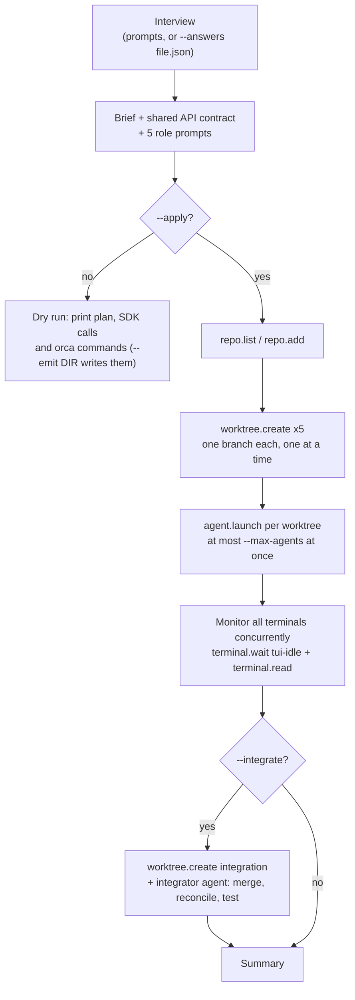

# Full-stack app with parallel agents

Interviews you about an app, writes a project brief and a shared API contract, and splits the work into five workstreams: database/schema, backend API, frontend UI, tests/CI and docs. Each workstream gets its own Orca worktree on its own branch and its own agent (claude by default). `AsyncOrca` watches every agent terminal at once. With `--integrate`, an integrator agent then merges the finished branches and runs the tests.



```bash
# Interactive interview, dry run against the current repo
uv run examples/fullstack-agent-orchestration/main.py

# Non-interactive, against another repo; write brief, contract and prompts to plan/
uv run examples/fullstack-agent-orchestration/main.py ~/src/teamboard \
    --answers examples/fullstack-agent-orchestration/answers.json --integrate --emit plan/

# For real: 5 worktrees and agents, 3 running at a time, then integrate
uv run examples/fullstack-agent-orchestration/main.py ~/src/teamboard \
    --answers examples/fullstack-agent-orchestration/answers.json \
    --max-agents 3 --agent-timeout 3600 --integrate --apply
```

Point it at a git repo with at least one commit, such as an empty project you just ran `git init` and an initial commit in. Each agent commits to its own branch and never pushes.

## How it works

1. **Interview.** Asks for the app name and idea, core features, users and auth, the main data entities (`task: title, status, due_date`), the frontend, backend and database stack, and the deployment target. `--answers` reads the same keys from JSON instead; see [answers.json](answers.json). Entities may also be `{"name": "task", "fields": {"title": "string"}}`.
2. **Plan.** The answers become a markdown brief and a shared API contract: base URL, error envelope, pagination, auth endpoints and CRUD endpoints with fields for every entity. Every agent's prompt has its role, the directories it owns (`db/`, `backend/`, `frontend/`, `tests/` + `.github/`, `docs/` + `README.md`), the brief and the contract. Agents that need a contract change write it to `CONTRACT_CHANGES.md` and leave the contract as it is, so the workstreams keep agreeing on interfaces.
3. **Setup.** Finds the repo with `repo.list()` or registers it with `repo.add(path=...)`. Then it runs `worktree.create(repo="id:...", name="<prefix>-<workstream>", no_parent=True)` for each workstream. These run one at a time, because they all lock the same git repo. A worktree that already exists with that name is reused.
4. **Orchestration.** One coroutine per workstream calls `agent.launch(agent=..., worktree="id:<worktree id>", prompt=..., surface="terminal")`. An `asyncio.Semaphore(--max-agents)` caps how many run at once. After `--settle` seconds, each one waits for `terminal.wait(for_="tui-idle", timeout_ms=...)` in `--poll` sized slices, using `with_options(timeout=...)` so the subprocess outlives the wait. Between slices it calls `terminal.read()` to update the dashboard and detect an exited terminal. A failed launch, an exited terminal and `--agent-timeout` each mark only that workstream; the others carry on. A status board prints every `--status-every` seconds.
5. **Integration.** With `--integrate`, it creates `<prefix>-integration` and launches an integrator agent that merges the idle branches in dependency order, reconciles `CONTRACT_CHANGES.md`, runs migrations and tests, fixes failures, and writes `INTEGRATION.md`. Then it prints a summary of branch, path, result and duration for each workstream. The exit code is 0 only if every agent went idle.

## Options

| Flag | Default | |
| --- | --- | --- |
| `repo` | `.` | target git repo |
| `--answers FILE` | interactive | interview answers as JSON |
| `--agent` / `--model` | `claude` / agent default | agent for every workstream |
| `--max-agents` | 3 | agents running at once |
| `--agent-timeout` | 3600 s | per-agent limit to reach tui-idle |
| `--poll` / `--settle` / `--status-every` | 60 / 20 / 30 s | wait slice, grace after launch, board interval |
| `--prefix` / `--base-branch` | app-name slug / repo default | worktree names and base ref |
| `--emit DIR` | off | write `brief.md`, `contract.md`, `prompts/*.md` (works in dry run) |
| `--integrate` | off | run the integrator after the workstreams |
| `--apply` | off | actually create worktrees and launch agents |

**SDK calls:** `AsyncOrca`, `status()`, `repo.list()`, `worktree.list(repo=...)`, and with `--apply`: `repo.add(path=...)`, `worktree.create(repo=..., name=..., no_parent=True, base_branch=...)`, `agent.launch(agent=..., worktree=..., prompt=..., model=..., surface="terminal")`, `terminal.wait(terminal=..., for_="tui-idle", timeout_ms=...)`, `terminal.read(terminal=..., limit=...)`, `with_options(timeout=...)`

**Changes state:** only with `--apply`, and it changes a lot: it can register a repo, create up to six worktrees and branches, and start up to six agents that write and commit code. Run the dry run first, and read the emitted prompts.
